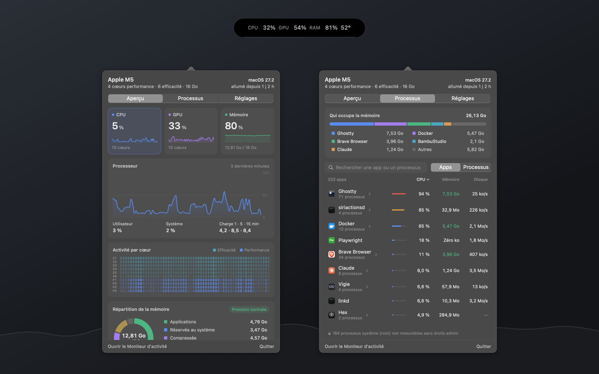

<p align="center"></p>

# Vigie

Moniteur système pour la barre des menus de macOS, écrit entièrement en Swift.

- **Dans la barre :** CPU, GPU, mémoire et température de la puce en pourcentages, et c'est tout.
- **En cliquant :** un panneau détaillé avec l'historique du processeur, du GPU et de la mémoire, l'activité par cœur, la répartition de la mémoire (survolez pour savoir ce que contient chaque compartiment), le réseau, le disque, la température et la batterie.
- **Processus :** regroupés par application, avec leur icône. Les outils de développement sont reconnus : « Serveur Next.js » avec le dossier du projet, Vite, Playwright, Claude Code…
- **Léger :** moins de 1 % de CPU panneau fermé, et rien du tout pendant la veille.

<p align="center"></p>

## Télécharger

**[⬇ Télécharger Vigie (dernière version)](https://github.com/freezer71/vigie/releases/latest)**

Nécessite macOS 14 ou plus récent, sur un Mac Apple Silicon (M1 ou plus récent).

1. Téléchargez **`Vigie-x.y.dmg`** dans la dernière version, puis ouvrez-le.
2. Dans la fenêtre qui s'affiche, glissez **Vigie** sur le dossier **Applications**.
3. À la première ouverture, macOS bloque l'app parce qu'elle n'est pas signée avec un compte développeur Apple. Allez dans **Réglages Système → Confidentialité et sécurité**, puis cliquez sur **Ouvrir quand même**.
   En ligne de commande : `xattr -dr com.apple.quarantine /Applications/Vigie.app`

L'app seule existe aussi en `.zip`, dans la même release.

## Compiler soi-même

Il faut les outils de ligne de commande Xcode (Swift 5.10 ou plus récent).

```sh
./scripts/build.sh            # produit build/Vigie.app
./scripts/build.sh --install  # l'installe dans /Applications et la lance
./scripts/package.sh          # produit le DMG et le zip de distribution dans build/
```

Clic : le panneau. Clic droit : le menu (Moniteur d'activité, Quitter).

## Logo et visuels

Le logo est dessiné en SVG par `scripts/make-logo.py` (il faut `brew install librsvg`). Le script produit `design/logo/` (couleur, monochrome, symbole noir et blanc, en SVG, PDF et PNG) et l'icône de l'app `Resources/AppIcon.icns`.

Les visuels de présentation sont dans `design/media/` : `hero.png` pour le README et `social-preview.png` (1280 × 640) pour la miniature des liens. Ils sont composés par `scripts/make-media.swift` à partir des vraies captures de `design/screenshots/`. Pour refaire une capture avec des graphiques bien remplis, lancez `open build/Vigie.app --args -debugOpen overview -debugOpenDelay 190` : le panneau s'ouvre après trois minutes d'historique.
