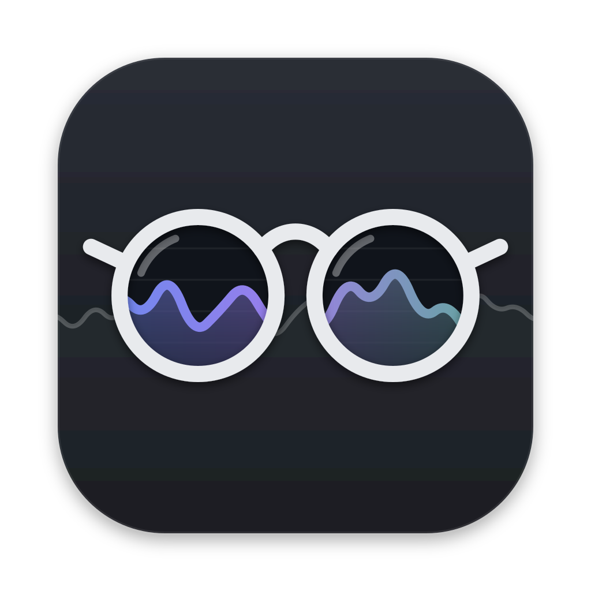

<p align="center"></p>

# Vigie

Moniteur système pour la barre des menus de macOS, écrit entièrement en Swift.

- **Dans la barre :** CPU, GPU, mémoire et température de la puce en pourcentages, et c'est tout.
- **En cliquant :** un panneau détaillé avec l'historique du processeur, du GPU et de la mémoire, l'activité par cœur, la répartition de la mémoire (survolez pour savoir ce que contient chaque compartiment), le réseau, le disque, la température et la batterie.
- **Processus :** regroupés par application, avec leur icône. Les outils de développement sont reconnus : « Serveur Next.js » avec le dossier du projet, Vite, Playwright, Claude Code…
- **Léger :** moins de 1 % de CPU panneau fermé, et rien du tout pendant la veille.

## Prérequis

macOS 14 ou plus récent, sur un Mac Apple Silicon. Il faut aussi les outils de ligne de commande Xcode (Swift 5.10 ou plus récent).

## Compiler et lancer

```sh
./scripts/build.sh            # produit build/Vigie.app
./scripts/build.sh --install  # l'installe dans /Applications et la lance
```

Clic : le panneau. Clic droit : le menu (Moniteur d'activité, Quitter).

## Logo

Le logo est dessiné en SVG par `scripts/make-logo.py` (il faut `brew install librsvg`). Le script produit `design/logo/` (couleur, monochrome, symbole noir et blanc, en SVG, PDF et PNG) et l'icône de l'app `Resources/AppIcon.icns`.
